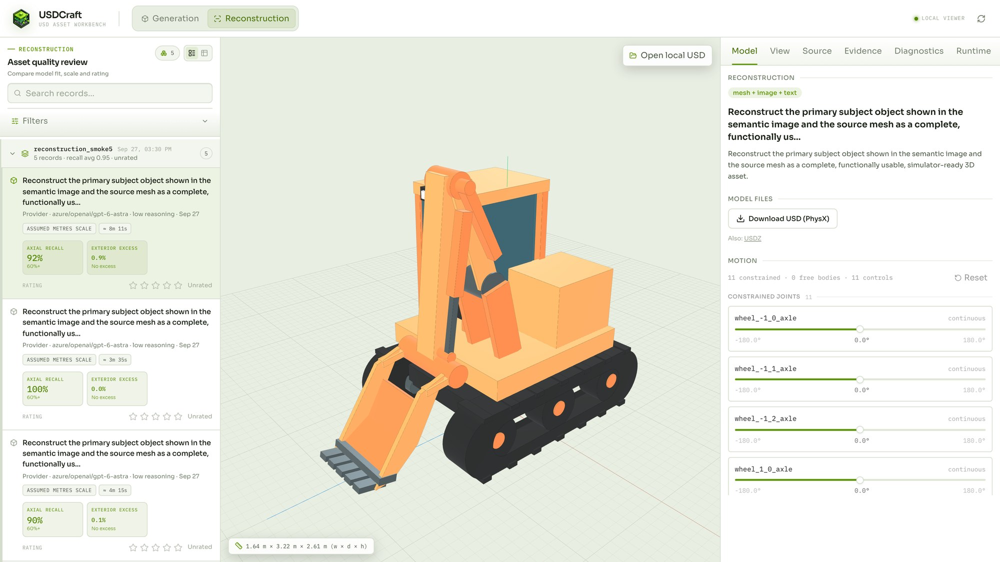

<div id="top" align="center">

# USDCraft: Geometrically Grounded Programmatic Modeling of Articulated 3D Assets for Simulation

[](https://arxiv.org/abs/2610.11322) [](https://nvlabs.github.io/USDCraft/v1/) [](https://huggingface.co/datasets/nvidia/USDCraft-10K) [](LICENSE)

</div>

USDCraft builds simulator-ready articulated 3D assets with an AI agent. **Generation** creates a new
asset from a text request and/or a reference image; **Reconstruction** rebuilds a real object from a
scanned or generated mesh plus one photo of it. In both cases the agent writes the asset as a Python
program (`model.py`) with the USDCraft SDK, checks and repairs it against renders and geometry
measurements, and USDCraft exports it to URDF, USD and USDZ with PhysX and Newton physics. Every
result is stored as a local record that you can inspect, articulate, rate and download in the
viewer.



---

## Quickstart with Codex

Open this repository in [Codex](https://openai.com/codex/) and ask:

- *"Install USDCraft."*: Codex checks the [prerequisites](#1-prerequisites) and installs the
  dependencies.
- *"Help me generate a compact desk lamp via Codex."*
- *"Help me reconstruct assets/reconstruction/cabinet/mesh.glb with assets/reconstruction/cabinet/photo.jpg via Codex."*
- *"Help me run assets/generation/generation_batch.csv via the API."*

Codex reads [`AGENTS.md`](AGENTS.md) and runs the matching command. "Via Codex" runs the agent on
your Codex account (no API key, no time or turn limit): Codex first shows a short summary and starts
after you approve, or right away if you ask it to start directly. The agent uses the same model and
reasoning effort as your Codex conversation; to use others, name them in your request (for example
*"... via Codex with gpt-6-astra, low effort"*). "Via the API" runs the API-key workflow
[below](#3-add-your-api-key) and starts immediately.

## Full installation and usage

### 1. Prerequisites

- macOS or Linux, Python 3.12
- [`uv`](https://docs.astral.sh/uv/)
- Node.js ^20.19 or >=22.12 with npm (builds the viewer and the renderer)

### 2. Setup

From the repository root:

```bash
uv sync
uv run usdcraft setup
```

`usdcraft setup` installs the Chromium browser used for rendering (Playwright downloads it together
with its FFmpeg build, which USDCraft does not use; see
[`THIRD_PARTY_NOTICES.md`](THIRD_PARTY_NOTICES.md)), builds the viewer and creates the `data/`
folders. Rerun it after pulling changes to `viewer/web`. On Ubuntu, if Chromium reports missing
system libraries, run `uv run playwright install-deps chromium` once.

**NOTICE AND DISCLAIMER: This software automatically retrieves, accesses or interacts with external materials.  Those retrieved materials are not distributed with this software and are governed solely by separate terms, conditions and licenses.  You are solely responsible for finding, reviewing and complying with all applicable terms, conditions, and licenses, and for verifying the security, integrity and suitability of any retrieved materials for your specific use case. This software is provided "AS IS", without warranty of any kind. The author makes no representations or warranties regarding any retrieved materials, and assumes no liability for any losses, damages, liabilities or legal consequences from your use or inability to use this software or any retrieved materials. Use this software and the retrieved materials at your own risk.**

### 3. Add your API key

Copy the example file and set `OPENAI_API_KEY` in `.env`:

```bash
cp .env.example .env
# edit .env: OPENAI_API_KEY=your-key
```

`OPENAI_MODEL` and `OPENAI_BASE_URL` in `.env` change the model and the endpoint (for example an
OpenAI-compatible proxy).

The default model is GPT-6 Astra (`gpt-6-astra`) with reasoning effort `low`, and we recommend it:
it is the cheapest and fastest setting we tested and scored best in our benchmark
([see the paper](https://arxiv.org/abs/2610.11322)). Higher effort (`--reasoning high`) tends to
over-work: runs take much longer, and the agent has a harder time balancing the fit to the mesh
against the rest of the model.

Choose another model with `--model` and the reasoning effort with `--reasoning` on any command. We
have run USDCraft with GPT, Gemini and Claude models:

| Models | Settings |
| --- | --- |
| GPT | Defaults |
| Gemini (through an OpenAI-compatible endpoint) | No extra settings (we ran it with `--reasoning high`) |
| Claude (through an OpenAI-compatible endpoint) | Defaults; if the endpoint rejects an explicit reasoning effort, add `--reasoning provider-default` |

```bash
uv run usdcraft generation "a desk lamp" --model <claude-model> --reasoning provider-default
```

Requests use the OpenAI Responses API by default. For an endpoint or model that only offers Chat
Completions, add `--api-style chat-completions`; Claude also works this way.

No API key? See [Quickstart with Codex](#quickstart-with-codex).

### 4. Generate an asset

From text, from an image, or both (the text then adds to or overrides what the image shows):

```bash
uv run usdcraft generation "A kitchen base cabinet with two hinged doors and one drawer on top"
uv run usdcraft generation --image assets/generation/forklift.jpg
uv run usdcraft generation --image assets/generation/microwave.jpg "a microwave with a mechanical timer dial"
```

Progress streams to the terminal. With the default model a run usually takes 5 to 10 minutes and
ends with the new `record_id`.

### 5. Reconstruct an object

Give the mesh and one photo of the same object:

```bash
uv run usdcraft reconstruction assets/reconstruction/cabinet/mesh.glb --image assets/reconstruction/cabinet/photo.jpg
```

The mesh can be GLB, glTF, OBJ, STL, PLY, OFF, XYZ or USD. Useful options:

| Option | Use |
| --- | --- |
| `--up-axis +Z`, `--front-axis=-Y` | Axes, when the file does not carry them (write a negative axis with `=`) |
| `--meters-per-unit 0.001` | Unit scale, when the file does not carry it; otherwise a unitless mesh is sized from the photo |
| `--guidance "..."` | Your own notes for the agent |
| `--mesh-cleanup` | First remove background and detached clutter from the mesh (off by default) |
| `--no-image-observation` | Skip the separate photo inventory step (the photo is still used) |
| `--label` | Display name |

### 6. Run a batch

A batch runs one CSV row per asset. The example CSVs in `assets/` cover every example input:

```bash
uv run usdcraft generation-batch assets/generation/generation_batch.csv --concurrency 4
uv run usdcraft reconstruction-batch assets/reconstruction/reconstruction_batch.csv --concurrency 2
```

`assets/reconstruction/reconstruction_batch.csv`:

```csv
row_id,source_path,image_path,mesh_cleanup
excavator,excavator/mesh.glb,excavator/photo.jpg,
paper_cutter,paper_cutter/mesh.glb,paper_cutter/photo.jpg,
cabinet,cabinet/mesh.glb,cabinet/photo.jpg,
```

Paths resolve from the CSV's folder and an empty cell means the default. Generation rows use
`row_id,prompt,image_path,label`. Add `--validate-only` to check a CSV without running it. Rows run
independently, and each may take up to 32 minutes (`--run-timeout SECONDS`, `0` for no limit).
Every column is listed in the [Generation](usdcraft/generation/README.md#generation-csv) and
[Reconstruction](usdcraft/reconstruction/README.md#reconstruction-csv) references.

### 7. Open the viewer

```bash
uv run usdcraft viewer                              # http://127.0.0.1:8770
uv run usdcraft viewer --read-only --host 0.0.0.0   # a review copy others can open: no rating, no deletion
```

The viewer shows each asset's inputs, the 3D result with its joints, run settings and diagnostics,
star ratings and downloads of the compiled USD. Reconstruction records also overlay the source mesh
on the result.

## Example assets

`assets/` holds the inputs used above so you can try USDCraft right away:

- `assets/generation/`: two reference images and `generation_batch.csv` (two text requests, two
  image requests).
- `assets/reconstruction/`: three objects, each with `mesh.glb` and `photo.jpg`, and
  `reconstruction_batch.csv`.

The example meshes were generated with USDCraft and the photos were taken by the authors; they are
NVIDIA material released under the repository license (see [`NOTICE`](NOTICE)).

## Where results are stored

Everything a run keeps lives under `data/` (ignored by git):

- `data/records/<record_id>/`: the record, with the generated `model.py`, its inputs and history.
- `data/cache/record_materialization/<record_id>/`: the exported `model.urdf`, `model.usdz` and the
  physics USD files `isaac/model.usdc` (PhysX) and `isaac/model_newton.usdc` (Newton). Rebuild them
  from `model.py` with `uv run usdcraft rematerialize <record_id>` (for a Generation record).
- `data/local/`: working folders of failed runs (or of any run with `--keep-workspace`).

Generated `model.py` files are Python code that runs on your machine without a sandbox, so only
run records from sources you trust; the viewer has no login, so if you bind it beyond localhost with
`--host`, put your own access control in front of it.

## Acknowledgements

USDCraft builds on [Articraft](https://github.com/articraftresearch/Articraft)
([arXiv:2605.15187](https://arxiv.org/abs/2605.15187)), whose articulated-object SDK and viewer were
our starting point; we thank its authors for releasing their work openly. We also thank
[CadQuery](https://github.com/CadQuery/cadquery) and [cq_gears](https://github.com/meadiode/cq_gears),
whose documentation, examples and gear generator our SDK adapts. Derived files say so in their
license header, and [`NOTICE`](NOTICE) lists the details.

## Citation

If you use USDCraft in your research, please cite the paper:

```bibtex
@article{zhang2026usdcraft,
  title={USDCraft: Geometrically Grounded Programmatic Modeling of Articulated 3D Assets for Simulation},
  author={Zhang, Chuanrui and Yang, Zaijia and Wang, Duomin and Shi, Lu and Zhou, Daquan and Zhang, Ruihua and Wang, Ziwei},
  journal={arXiv preprint arXiv:2610.11322},
  year={2026}
}
```

This repository is licensed under the [Apache 2.0 License](LICENSE). Third-party attributions are
in [`NOTICE`](NOTICE) and the full dependency inventory with license texts is in
[`THIRD_PARTY_NOTICES.md`](THIRD_PARTY_NOTICES.md). Contributions: see
[`CONTRIBUTING.md`](CONTRIBUTING.md).
